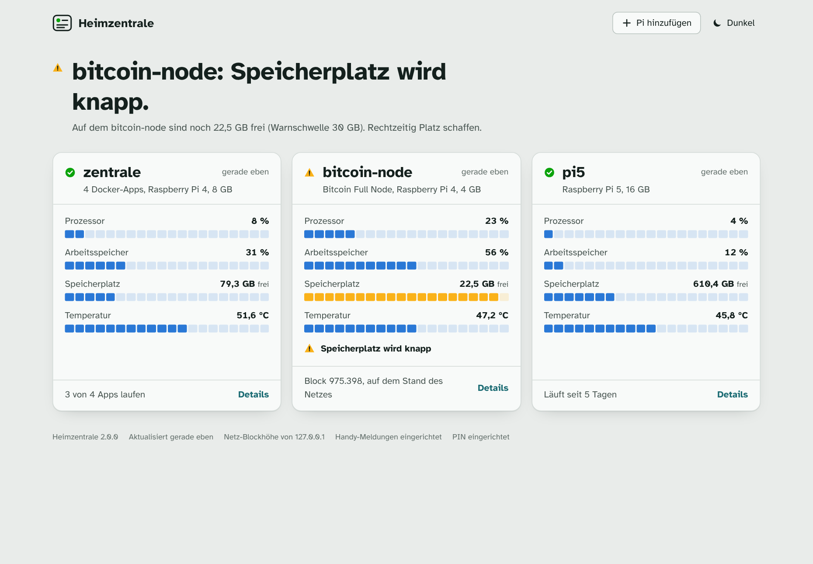
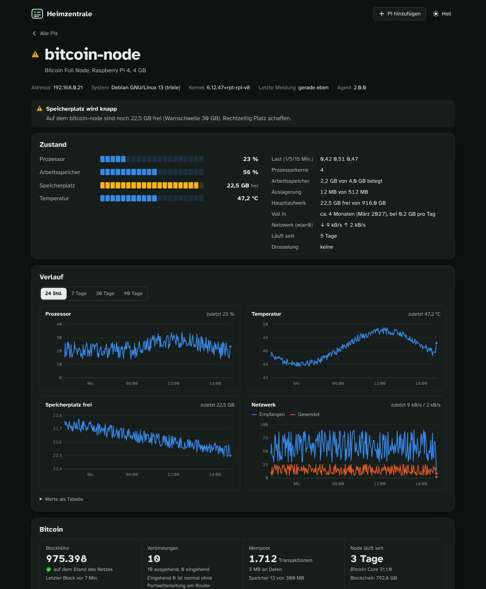
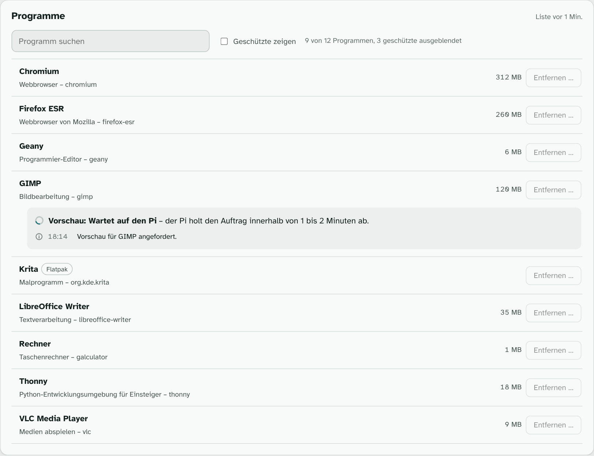

# Heimzentrale

Eine kleine Web-App für die Raspberry Pis im Heimnetz. Sie zeigt auf einen Blick, ob alles in Ordnung ist,
meldet Probleme aufs Handy und nimmt einem die Pflege ab: Bitcoin Core aktualisieren, Programme sauber entfernen,
weitere Pis anbinden.

*A small self-hosted dashboard for the Raspberry Pis in your home network (German UI). Runs on Raspberry Pi OS / Debian,
Python standard library only, no cloud.*



## Was sie kann

- **Übersicht aller Pis:** Prozessor, Arbeitsspeicher, Speicherplatz und Temperatur, dazu ein klarer Satz ganz oben,
  ob etwas Aufmerksamkeit braucht.
- **Detailseite je Pi:** Verlauf über 24 Stunden bis 90 Tage (Prozessor, Temperatur, Speicherplatz, Netzwerk),
  Prognose, wann der Speicher voll ist, Laufwerke, Docker-Apps.
- **Bitcoin Full Node:** Blockhöhe im Vergleich zum Netz, Verbindungen, Mempool – und **Bitcoin-Core-Update per Knopf**:
  Der Pi lädt die neue Version von bitcoincore.org, prüft Prüfsumme und die Signaturen der Entwickler (guix.sigs,
  mindestens 5 gültige, keine ungültige), tauscht das Programm aus und spielt die alte Version zurück, wenn die neue
  nicht startet.
- **Programme entfernen:** Liste der installierten Programme (mit Menüeintrag, apt und Flatpak). Vor dem Entfernen zeigt
  eine Vorschau genau, welche Pakete mitgehen und wie viel Platz frei wird. Teile des Grundsystems, der Oberfläche,
  von SSH und Docker sind geschützt.
- **Handy-Meldungen** über [ntfy](https://ntfy.sh): Speicherplatz knapp, Pi meldet sich nicht, Node hängt hinter dem Netz,
  zu warm – jeweils einmal, mit Entwarnung.
- **PIN** für alles, was etwas verändert. **Hell und Dunkel**, für Handy und Bildschirm.

| Detailseite (dunkel) | Programme entfernen |
|---|---|
|  |  |

## Installation

Auf dem Pi, der die Seite anzeigen soll (Raspberry Pi OS oder Debian, im Terminal):

```bash
curl -fsSL https://raw.githubusercontent.com/EserYueksel/heimzentrale/main/install.sh | sudo bash
```

Der Installer

1. kopiert die Heimzentrale nach `/opt/heimzentrale` (mit CasaOS: `/DATA/AppData/heimzentrale`),
2. startet sie mit Docker, wenn Docker da ist, sonst als systemd-Dienst,
3. erzeugt einen Schlüssel für die Agenten und fragt nach einer **PIN** und optional nach einem **ntfy-Kanal**,
4. richtet auf diesem Pi gleich den Agenten ein und legt einen Eintrag „Heimzentrale“ im Programm-Menü an.

Danach ist die Seite unter `http://ADRESSE-DES-PI:8088` erreichbar.

**Weitere Pis anbinden:** Auf der Seite „Pi hinzufügen“ wählen, PIN eingeben und den angezeigten Befehl auf dem neuen
Pi ausführen. Er sieht so aus:

```bash
curl -fsSL http://ADRESSE:8088/install.sh | sudo bash -s -- agent http://ADRESSE:8088 SCHLÜSSEL
```

**Aktualisieren:** denselben Installationsbefehl noch einmal ausführen. Einstellungen, Schlüssel und Verlauf bleiben
erhalten, die vorherige Version liegt danach in `app.vorher`.

## Einstellungen

`data/heimzentrale.conf` im Installationsordner (Änderungen gelten nach spätestens einer Minute):

| Schlüssel | Bedeutung | Standard |
|---|---|---|
| `DISK_WARN_GB` / `DISK_CRIT_GB` | Warnung / dringend, wenn weniger frei | 30 / 10 |
| `SILENT_MIN` | so lange ohne Meldung = Pi meldet sich nicht | 20 |
| `BEHIND_BLOCKS` / `BEHIND_MIN` | Node hängt hinterher: Blöcke / Minuten am Stück | 3 / 20 |
| `TEMP_WARN` / `TEMP_CRIT` | Temperatur in °C | 70 / 75 |
| `DEVICE_ORDER` | Reihenfolge der Pis, z. B. `zentrale,bitcoin-node` | alphabetisch |
| `PUBLIC_URL` | Adresse für den Befehl „Pi hinzufügen“ | wird erkannt |
| `NTFY_TOPIC` | ntfy-Kanal (auch in `data/ntfy.conf`) | – |

PIN ändern: `sudo bash /opt/heimzentrale/app/install.sh pin` (bzw. im CasaOS-Ordner).

Auf jedem Pi liegt `/etc/heimzentrale-agent.conf` mit `HZ_URL` und `HZ_TOKEN`. Optional: `DISKS="/ /mnt/daten"` für weitere
Laufwerke, `OWN_ALARMS=1`, wenn der Pi Hitze und Ausfälle schon mit einem eigenen Skript meldet.

## Sicherheit

- Gedacht fürs **Heimnetz**. Nicht ins Internet freigeben (keine Portweiterleitung). Für unterwegs gibt es die Handy-Meldungen.
- Die Agenten melden sich mit einem **Schlüssel**; Seiten im Browser können ohne **PIN** nichts verändern
  (5 falsche Versuche sperren die Knöpfe 15 Minuten).
- Die Agenten öffnen keinen Port. Sie fragen jede Minute selbst nach Aufträgen.
- Ein Agent führt nur drei Arten von Aufträgen aus: Bitcoin-Core-Update (nur neuere Versionen, nur mit gültigen
  Signaturen), Vorschau und Entfernen eines Programms (nur wenn es seit der Vorschau gleich geblieben ist und kein
  geschütztes Paket betroffen ist).
- Persönliche Einstellungen im Benutzerordner bleiben beim Entfernen erhalten.

## Entfernen

- Agent auf einem Pi: `sudo bash install.sh agent-entfernen`
- Heimzentrale (systemd): `sudo systemctl disable --now heimzentrale` und den Ordner `/opt/heimzentrale` löschen;
  mit Docker: `sudo docker compose down` im Installationsordner.

## Aufbau

```
install.sh                 Installer (Heimzentrale, Agent, PIN)
docker-compose.yml         für Docker/CasaOS
app/server.py              Startpunkt (serve | status | test-ntfy | pin)
app/hz/                    Server in kleinen Modulen (config, db, metrics, checks, alerts, core, tasks, status, web …)
app/agent/heimzentrale-agent   Agent für jeden Pi (eine Python-Datei)
app/static/                Seite: HTML, CSS, JavaScript-Module, Schrift Atkinson Hyperlegible (OFL)
app/tests/                 automatische Tests
```

Nur Python-Standardbibliothek (ab 3.9), keine Pakete aus dem Internet, kein Build-Schritt.

Tests (im Ordner `app/`):

```bash
python3 -m unittest -v
HZ_NET_TESTS=1 python3 -m unittest tests.test_agent   # inkl. echter Signaturprüfung mit guix.sigs
```

## Lizenz

MIT, siehe [LICENSE](LICENSE). Die Schrift Atkinson Hyperlegible steht unter der SIL Open Font License
(`app/static/fonts/OFL-Atkinson-Hyperlegible.txt`).
